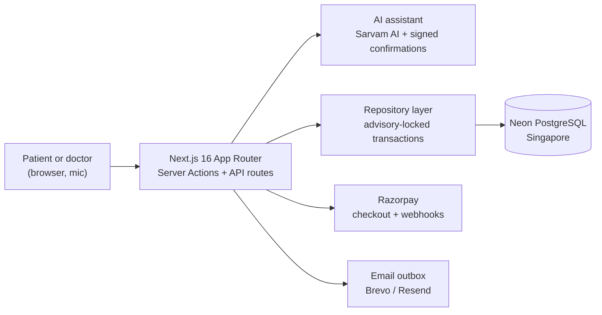

<div align="center">

# 🏥 Medrella Healthcare

### Outpatient booking, payments and a multilingual voice AI assistant for Ruby Hall Clinic, Pune

<a href="https://medrella-healthcare.vercel.app"></a>
<a href="https://github.com/atharva1407-sys/Pearl_Thoughts_Atharva-Mandlik"></a>


</div>

---

## What this is

The production build of Medrella: patients find a doctor, book a slot, pay online and get email reminders; doctors manage their own schedule and queue. A **voice AI assistant** (English, Hindi, Marathi, Hinglish) lets both sides do all of that by chatting, and it always asks for an explicit **Confirm** before booking, cancelling or rescheduling.

| | |
|---|---|
| 🤖 **AI assistant** | Text or hands-free voice. Patients book, reschedule, cancel and pay in chat; doctors get schedule, stats, conflicts and free slots. Real backend actions, signed single-use confirmations, emergency messages routed to 112. |
| 📅 **Elastic scheduling** | Morning and evening sessions, Stream or Wave capacity, leave days. Stretch or shrink hours even with patients booked. |
| 🔒 **No double booking** | Transaction-scoped PostgreSQL advisory locks, with the slot rechecked right before commit. |
| 💳 **Payments** | Razorpay checkout, 10-minute seat holds, signature verification, idempotent webhooks, refunds of 100% / 50% / 0% by notice. |
| 📬 **Email outbox** | Brevo and Resend delivery with retries, IST-accurate reminders, no medical details in emails, admin dead-letter dashboard. |
| 💊 **Prescriptions** | Doctors write them for completed visits; patients read them in the portal or by asking the assistant. |

## How it fits together



| Layer | What is used |
|---|---|
| **App** | Next.js 16 (App Router), React 19, TypeScript 5, Tailwind CSS 4, Radix UI |
| **Data** | Neon serverless PostgreSQL, Drizzle ORM, additive migrations `0000` to `0007` |
| **Security** | PBKDF2 password hashing, signed HTTP-only session cookies, role-based access, rate limiting, strict production env checks |
| **AI and voice** | Sarvam AI for chat and speech-to-text, browser speech synthesis, Zod-validated tool calls |
| **Hosting** | Vercel (functions in Singapore, next to the database), GitHub Actions CI |

## 🎬 2-minute demo (what to click)

Open the **[live app](https://medrella-healthcare.vercel.app)** and follow along:

1. **Home** shows the 8 specialists with each one's next open slot.
2. **Register** as a patient at `/register` (any email, 8+ character password).
3. Open the **assistant** (round button, bottom right): *"Find a cardiologist"*, then *"Book Dr. Mehta tomorrow around 10:00"*.
4. A **Confirm card** appears and nothing is booked until you press it. Pay with the Razorpay test details below.
5. Try *"Kal ke liye slot dikhao"* (Hinglish) or tap the **waveform** for hands-free voice; talk over the reply to interrupt.
6. Type *"I have chest pain"*: it answers with 112 guidance and never calls the AI.
7. Ask to **cancel**: the refund amount is shown before you confirm.
8. As a **doctor** (logins on request): ask *"Any scheduling conflicts this week?"*, shrink a booked session in **Weekly Shifts**, and add a prescription to a completed visit.

> **Razorpay test mode** (no real money): card `4718 6091 0820 4366`, expiry `12/28`, CVV `123`, or UPI `success@razorpay`.

## 🧭 Main screens

| Route | What it shows |
|---|---|
| `/` | Landing page, specialists, next open slots |
| `/doctors`, `/doctors/[id]` | Directory and the slot picker with the 10-minute seat hold |
| `/patient/dashboard` | Appointments and the assistant |
| `/patient/payments`, `/patient/prescriptions` | Receipts and refund status; prescriptions |
| `/doctor/dashboard`, `/doctor/availability` | Daily queue, Weekly Shifts, leave days |
| `/queue`, `/reports` | Live waiting queue; visit reports |
| `/admin/notifications` | Email outbox, failures and one-click retry (admin only) |
| `/api/health` | Health check with a database ping |

## ✅ Tests

**772 automated checks in 11 suites**, plus real-PostgreSQL concurrency tests and Playwright end-to-end tests, all run by GitHub Actions on every push.

| Area | Suites | Checks |
|---|---|:---:|
| Clinic rules, slots, queue, leave | `test-suite` | 115 |
| Payments, webhooks, refunds | `test-payment-hardening` | 72 |
| Notifications and email outbox | `test-notifications`, `test-brevo-welcome` | 112 |
| AI assistant, tools, voice detection | `test-agent`, `test-assistant` | 190 |
| Scheduling, timezones, elastic sessions | `test-scheduling`, `test-timezone`, `test-elastic` | 223 |
| Concurrency and appointment lifecycle | `test-phase1-hardening`, `test-phase3-lifecycle` | 60 |

```bash
npm test            # all 11 suites, no network needed
npm run test:pg     # real PostgreSQL concurrency tests
npm run test:e2e    # Playwright browser tests
```

## 🚀 Run and deploy

```bash
npm install
cp .env.example .env.local
npm run dev                 # http://localhost:3000
```

No database is needed to try it locally: set `DATABASE_URL=disabled-for-local-test`, `USE_MOCK_PAYMENTS=true` and `ENABLE_SEED_DATA=true` to run in memory with the 8 specialists.

**Production on Vercel** needs these environment variables: `DATABASE_URL`, `SESSION_SECRET` (32+ characters), `CRON_SECRET` (16+ characters), `APP_URL`, the `RAZORPAY_*` keys, `SARVAM_API_KEY`, and `BREVO_API_KEY` or `RESEND_API_KEY`. The app refuses to run in production with weak or missing secrets. Run any new migration (for example `npm run db:migrate-0007`) on the database before deploying code that reads new tables.

Details: [Environment variables](ENVIRONMENT_VARIABLES.md) · [Deployment guide](PRODUCTION_DEPLOYMENT_GUIDE.md) · [Database migrations](DATABASE_MIGRATION_GUIDE.md) · [Testing guide](TESTING_GUIDE.md) · [Release notes](RELEASE_NOTES.md)

---

<div align="center">

Built by **Atharva Mandlik** for **Pearl Thoughts**, for Medrella Healthcare, Ruby Hall Clinic, Pune.

</div>
