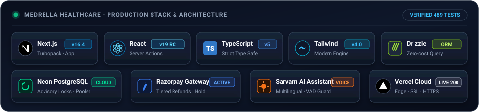

<div align="center">

# 🏥 Medrella Healthcare — Outpatient Platform & AI Assistant

<p align="center">
  
</p>

Full-stack outpatient clinical management platform featuring an **AI Assistant for Patients & Doctors** (voice & text), **Elastic Scheduling**, **Prescription Management**, and **Reliable Outbox Notifications** for **Medrella Healthcare, Ruby Hall, Pune, Maharashtra**.

🚀 **Live Production Application**: [https://medrella-healthcare.vercel.app](https://medrella-healthcare.vercel.app)

</div>

---

## 💎 Platform Core Innovations

> [!NOTE]
> ### 🤖 AI Assistant for Patients & Doctors (Floating Chat on Dashboards)
> **Text or voice, English / Hindi / Marathi / Hinglish** · Powered by Sarvam AI (`sarvam-105b-conversations`) with speech-to-text. The assistant performs **real clinical actions** (slots, bookings, payments, refunds, prescriptions) through validated server actions. **Every booking, cancellation and reschedule requires an explicit Confirm press** on a signed, 5-minute, single-use token card. Emergency keywords (English, Hindi, Marathi, Hinglish) route straight to **112** without contacting the model.

> [!TIP]
> ### 📅 Elastic Session Scheduling (`src/lib/elastic-schedule.ts`)
> **Dynamic Clinic Hours** · Doctors can stretch or shrink existing OPD sessions (Weekly Shifts → Edit) **even when appointments are booked**. Live preview calculates added or removed slots. If hours shrink past booked patients, doctors choose: **Move to Nearest Slot** (default), **Cancel & Refund**, or **Keep as Booked**.

> [!IMPORTANT]
> ### 📩 Proactive Patient Engagement Jobs (`/api/cron/engagement`)
> **Care Follow-Up & Retention** · Automated cron jobs run daily: post-visit follow-ups sent after consultation completion, preventive care reminders (90 days), and patient re-engagement nudges (180 days). Promotional messages are strictly gated by patient opt-in preferences.

---

## 🧭 Assistant Pipeline & Safety Architecture

| Step | Component | Safety & Privacy Implementation |
|:---:|---|---|
| **1** | **Request** | Signed-in patients **or doctors** only, same-origin check, rate limit of 20 messages per 10 minutes. Session context is extracted from signed HTTP-only cookies, never from client body. |
| **2** | **Emergency Filter** | English, Hindi, Marathi, and Hinglish keywords route to **112 Emergency Care** instantly before reaching the LLM. |
| **3** | **Role-Scoped Tools** | The caller's session role dictates available tools: doctors cannot call patient booking tools, and patients cannot call doctor schedule tools. Arguments validated with Zod. |
| **4** | **Propose, Then Confirm** | Mutating actions (`propose_booking`, `propose_cancel_appointment`, `propose_reschedule_appointment`) produce a HMAC-signed card (5-minute expiration, single-use). No DB state changes occur until the patient presses **Confirm**. |
| **5** | **Atomic Revalidation** | `POST /api/agent/confirm` verifies cryptographic token integrity, re-checks slot availability, doctor status, and user ownership against live PostgreSQL before executing the transaction. |
| **6** | **Payment & Holds** | Paid visits hold the slot and render a secure **payment card** in chat (Razorpay Gateway / Test Mode). Expired or abandoned payments release held slots automatically. |
| **7** | **Audit Trail** | All tool calls, confirmations, and errors are recorded in `agent_events` with sanitized identifiers; PHI (names, emails, phone numbers) is never logged. |

---

## 🛠️ Tool Catalog & Clinical Features

### Patient Tools (Assistant)
| Tool | Clinical Purpose |
|---|---|
| `search_doctors` | Find specialists by name, clinical department, consultation fee, or experience. |
| `get_open_slots` | Retrieve real-time available consultation slots formatted as interactive chips. |
| `suggest_alternative_slots` | Suggest nearest alternative slots when a requested time is unavailable. |
| `list_my_appointments` | Query upcoming, past, or cancelled patient appointments. |
| `propose_booking` / `propose_cancel_appointment` / `propose_reschedule_appointment` | Generate a 2-step signed confirmation card with refund calculation. |
| `list_my_payments` | Display payment transaction history and refund processing status. |
| `list_my_prescriptions` | View active clinical prescriptions and doctor dosage instructions. |

### Doctor Tools (Assistant)
| Tool | Clinical Purpose |
|---|---|
| `get_my_appointments` | View daily OPD consultation schedule filtered by status (`BOOKED`, `COMPLETED`). |
| `get_appointment_stats` | Real-time counts of patient visits, completed consultations, and cancellations. |
| `get_my_schedule` | Inspect working shifts, recurring patterns, and clinical leave dates. |
| `find_schedule_conflicts` | Detect overlapping sessions, overbooked slots, or leave day collisions. |
| `get_my_open_slots` | Check available open capacity for a designated clinic day. |
| `suggest_reschedule_slots` | Propose optimal open slots to reschedule existing patient visits. |

---

## 🔄 Elastic Scheduling Resolution Options

When editing session hours that affect booked patients, the system requires an explicit clinical resolution:

| Resolution Strategy | Clinical Behavior | Notification & Refund |
|---|---|---|
| **Move to Nearest Slot** *(Default)* | Re-assigns booked patients to the closest available slot within the new session hours. | Patients are notified of their new time via email outbox. |
| **Cancel & Refund** | Cancels affected bookings and triggers an automated 100% full refund via the payment gateway. | Cancellation and refund confirmation emails are queued immediately. |
| **Keep as Booked** | Preserves existing appointments at their original times even if outside standard shift bounds. | Existing booking confirmation remains unchanged. |

---

## ⚡ Verification & Test Suite

```bash
cd Task_6
npm install
npm test                  # Runs 489 automated tests across 11 suites (zero network needed)
npm run test:pg           # Runs real PostgreSQL concurrency and advisory lock tests
npm run build             # Turbopack production build
```

| Test Suite | Tests | Result | Verification Scope |
|---|:---:|:---:|---|
| **`src/test-suite.ts`** | **115** | **Passed** | Clinical rules, wave/stream capacity, token sequences, and double-booking guard. |
| **`src/test-payment-hardening.ts`** | **72** | **Passed** | Razorpay webhooks, signature verification, seat holds, and tiered refund engine. |
| **`src/test-notifications.ts`** | **81** | **Passed** | Outbox deduplication, IST midnight calculations, PHI redaction, and DLQ retries. |
| **`src/test-brevo-welcome.ts`** | **31** | **Passed** | Welcome notification pipeline, template escaping, and non-blocking delivery. |
| **`src/test-agent.ts`** | **72** | **Passed** | Sarvam AI tool calling, safety checks, multilingual emergency triage, and crons. |
| **`src/test-assistant.ts`** | **99** | **Passed** | Doctor tools, confirmed booking/cancel/reschedule, expired/forged confirmations, slot taken guards, and VAD audio handling. |
| **`src/test-timezone.ts`** | **4** | **Passed** | Hospital timezone rules evaluated across UTC, Asia/Kolkata, America/Los_Angeles, Pacific/Auckland. |
| **`src/test-scheduling.ts`** | **114** | **Passed** | Wave & stream recurrence, specific-date shifts, and timezone cross-checks. |
| **`src/test-elastic.ts`** | **23** | **Passed** | Live OPD session expansion, shrinkage, slot calculation, and clinical conflict resolution. |
| **`src/test-phase1-hardening.ts`** | **48** | **Passed** | Distributed rate limiting, environment validation, background sweep safety, and advisory locks. |
| **`src/test-phase3-lifecycle.ts`** | **12** | **Passed** | Appointment state machine transitions, concurrency guards, and deterministic refund idempotency. |
| **Total Test Suite** | **489 Passed** | **0 Failed** | **100% Deterministic Verification** |
